# Temperature- and rate-dependent fracture from competing crack-tip kinetics

## Abstract

Temperature and loading rate affect fracture through competition between crack opening and crack-tip accommodation. We formulate opening as a stochastic first-passage process coupled to persistent, reusable dislocation-source populations and evolving two-dimensional mechanics. In 96 original spatial sharp-wake calculations, four fixed constructed parameter rows produce transition-like elevation, broad accommodation-associated elevation, and predominantly softening responses without prescribing toughness curves. Matched opening-only controls show changes up to 156% for the DBTT row and 164% for the Peak row. Eight paired seeds at DBTT/1200 K and Peak/900 K give mean first-event gaps of 32.45 and 34.74 MPa√m, well above their observed seed spreads. Rate, orientation, and source-support tests show that the response is path dependent rather than a universal temperature shift. Developed trajectories reach 1.005 mm and provide event-conditioned resistance observations under monotonic loading. A common-specimen audit separates exact identical-mesh elastic agreement from systematic production differences in reaction and native J support. In a matched 0.2 s cavity continuation, the suppressed arm advances 80 µm whereas the enabled arm does not connect or advance; current native fields establish finite-window inhibition under the topology-aware candidate law, without equating unlike local and finite-ligament drives. The study therefore links thermally activated opening, inherited accommodation, cohesive topology, and cavities while stating the limits of each comparison.

## 1. Introduction

Fracture loading can rise, fall, or pass through a transition as temperature changes. The common language of a temperature-dependent fracture toughness summarizes these trends efficiently, but it does not by itself identify their physical origin. A local separation process may become faster with temperature while thermally activated dislocation processes simultaneously blunt or shield the crack tip. Loading rate changes the time available to both processes. The measured response is consequently determined by their competition along a loading history rather than by the temperature dependence of either process in isolation.

Classical fracture mechanics supplies the energetic and mechanical measures needed to describe a crack at the specimen scale [1,5]. Atomistic and continuum analyses of brittle–ductile competition add the possibility that dislocation emission can precede cleavage [2,3,6,7]. Transition-state theory supplies a common physical clock: each candidate process has a rate determined by its activation landscape and instantaneous drive [4]. These elements suggest a forward formulation in which opening is an absorbing first-passage event, whereas accommodation is nonabsorbing and changes the state encountered by later opening attempts.

The central question is not whether thermal activation can be appended to a prescribed toughness curve. It is whether specified opening and accommodation landscapes, coupled through mechanics and state evolution, can generate qualitatively different fracture–temperature and fracture–rate responses. Addressing that question requires more than a frozen competition between two rates. Emission changes mobile and retained process-zone content; transport and release determine whether that content persists; retained content shields opening; and crack advance changes which material and sources occupy the near-tip region.

We examine this coupling using two original spatial implementations. The principal calculation is a two-dimensional plane-strain field model with explicitly tracked sharp-wake crack increments and a moving, front-local kinetic state. A separate full FEM/CZM calculation tests whether the activated-opening organization transfers to a cohesive/topological crack representation and a different accommodation closure. A third full-order paired spatial calculation enables or suppresses cavity nucleation and growth while preserving the same loading and fracture random stream.

The calculations produce four constructed response families: a broad elevated or peak-capable response, a sharp transition-like elevation, weak temperature dependence with overall softening, and ceramic-like softening. These parameter families expose mechanisms rather than provide parameter-free predictions for named materials. The analysis asks how accommodation opposes intrinsic opening softening, why mechanically effective retained content differs from plastic activity alone, why rate effects can have opposite signs, how initiation differs from propagation, how cavities perturb a matched crack path, and which conclusions transfer between the original PF and FEM/CZM implementations.

## 2. Experimental motivation

Selected transmission-electron-microscopy sequences of crack opening in nominally 500 nm, 99.9% Ag leaf show contrasting near-tip behavior. One sequence contains extensive evolving line and band contrast described as dislocation motion and twinning, whereas a second sequence contains much less visible plastic contrast. Both show crack opening under displacement-controlled loading.

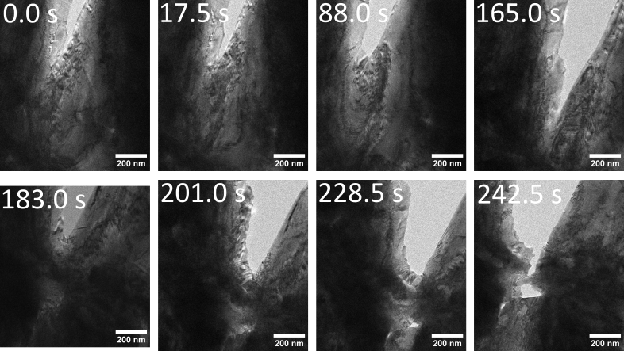

**Figure 1.** Selected Ag TEM frames showing crack opening accompanied by extensive evolving line and band contrast. The images motivate competition between opening and accommodation. Contrast depends on specimen thickness, diffraction condition, orientation, and temporal resolution, so limited contrast in the companion sequence does not prove the absence of plasticity.

The observations establish the physical motivation but do not quantitatively calibrate the model. The selected frames have nonuniform time labels, and synchronized force data are unavailable. The calculations therefore ask what responses follow from stated activation and accommodation laws; they do not fit the Ag sequences or assign the constructed families to Ag.

## 3. Competing-kinetics framework

### 3.1 Conditional first passage and activation surfaces

For a discrete event channel \(i\), with drive \(q_i\), state \(z\), multiplicity \(\mathcal M_i\), and attempt frequency \(\nu_i\), the executed conditional rate is

\[
\lambda_i(t)=\mathcal M_i(t)\nu_i\exp\!\left[-\frac{\Delta G_i^\ddagger(q_i,T,z)}{k_BT}\right]. \qquad (1)
\]

Here \(k_B\) is Boltzmann's constant and \(T\) is absolute temperature. Conditional on no intervening event, the next-event density contains only the channels represented as discrete events,

\[
f_i(t)=\lambda_i(t)\exp\!\left[-\int_{t_0}^{t}\sum_j\lambda_j(s)\,ds\right]. \qquad (2)
\]

The deterministic mean source-population update below changes the conditional rates but is not counted as another sampled event. Crack opening uses an exponential mark \(\Xi=-\ln R\), with \(R\sim U(0,1)\), and accumulated action

\[
A_c(t)=\int_{t_0}^{t}\Lambda_c[s;z(s)]\,ds,\qquad A_c(t_c)=\Xi . \qquad (3)
\]

Opening and emission use the executed EXP-floor activation surface

\[
G_i(\sigma,T)=G_{f,i}+[G_{0,i}(T)-G_{f,i}]\exp\!\left\{-\alpha_i\left[\frac{\max(\sigma,0)}{\sigma_{c,i}(T)}\right]^{n_i}\right\}. \qquad (4)
\]

Here \(G_{0,i}=G_{00,i}+g_{T,i}(T-T_{\rm ref})\) and \(\sigma_{c,i}=\sigma_{c0,i}+s_{T,i}(T-T_{\rm ref})\). The reference temperature is \(T_{\rm ref}=481.33\) K. The implementation floors \(G_0\) at \(10^{-9}\) eV and \(\sigma_c\) at 1 Pa, bounds \(G_f\) as given in the SI, and clips the Arrhenius exponent to \([-700,0]\). In the DBTT emission row, the affine stress scale reaches the 1 Pa floor near 1001 K; this bounded-stress assumption contributes materially to the calculated upper branch.

### 3.2 Mechanics, sign convention, and committed crack geometry

The principal calculation is plane strain in a 2 mm by 4 mm body with a 0.5 mm left-edge notch and symmetric total opening. The graded triangular discretization carries piecewise-constant plastic strain and density. With plane-strain modulus \(E'=E/(1-\nu^2)\), signed domain integral \(J_{\rm signed}\), and orientation sign \(\varsigma\), the reported coordinate is

\[
K_J=\sqrt{E'\max(\varsigma J_{\rm signed},0)} . \qquad (5)
\]

The sign makes forward mode-I energy release positive. \(K_J\) is a model observer, not a standardized experimental toughness. An accepted event commits a sampled sharp-wake increment; the calculation is not an AT1 or AT2 variational damage evolution.

### 3.3 Persistent source population and signed transport

The executed PF families use persistent reusable source sites, not a finite depleted inventory. For reduced slip system \(s\), the state-dependent multiplicity is

\[
\mathcal M_s=\rho_{\rm site}c_{\rm arc}r_{\rm tip}w_{\rm eff},\qquad
w_{\rm eff}=w_{\rm ref}\sqrt{\rho_{\rm ref}/\max(\rho,\rho_{\rm ref})}. \qquad (6)
\]

Here \(\rho_{\rm site}\) is persistent areal site density, \(c_{\rm arc}r_{\rm tip}w_{\rm eff}\) is active source area, \(r_{\rm tip}\) is the blunted radius, and \(w_{\rm eff}\) is bounded by the process-grid and domain widths. Sites are neither consumed nor replenished by crack advance. For a time interval \(\Delta t\), the mean activation increment is the nonnegative implicit root

\[
\Delta N_s=\mathcal M_s\lambda_e\!\left(\max[\sigma_{{\rm drive},s}-k_{\rm back}\sqrt{\rho_s+a_s\Delta N_s},0],T\right)\Delta t . \qquad (7)
\]

Here \(\sigma_{{\rm drive},s}\) is the tensor-resolved projected drive, \(k_{\rm back}\sqrt{\rho}\) is Taylor back stress, and \(a_s\) converts an activation to local density. Equation (7) is solved by a bracketed backward-Euler complementarity condition and is bounded by the density at which back stress blocks the resolved drive. The mean increment is converted to signed line content using a mechanically derived two-dimensional unit-perturbation normalization; its sign follows resolved shear.

Positive and negative mobile \(M_s^\pm\), retained \(R_s^\pm\), accumulated-slip, and wake populations are stored separately. For each sign, exact local exchange obeys

\[
\dot M_s^\pm=-k_{\rm enc}M_s^\pm+k_{\rm rel}R_s^\pm,\qquad
\dot R_s^\pm=k_{\rm enc}M_s^\pm-k_{\rm rel}R_s^\pm. \qquad (8)
\]

The exchange is followed by forward mobile transport \(v\Delta t\), with forest spacing \(\ell=(2\sqrt{\rho})^{-1}\), velocity \(v=\ell\lambda_p\), and \(k_{\rm enc}=\eta v\sqrt{\rho}\). The selected Taylor completion mapping defines \(k_{\rm rel}\) in the implementation; explicit mobile and retained temporal recovery are zero for these monotonic rows. Escape at the active-domain boundary and moving-frame transfer to the wake remain active and are separately ledgered.

Signed retained content acts through two-dimensional unit-response kernels,

\[
K_{\rm sh}=\sum_{s,j}\kappa_{s,j}(R_{s,j}^+-R_{s,j}^-),\qquad
r_{\rm eff}=r_0+c_{\rm blunt}b\sum_{s,j}w_j\Gamma_{s,j}. \qquad (9)
\]

The reported runs set the mobile shielding fraction and wake shielding to zero. Thus population, plastic work, back stress, blunting, and mechanical shielding are distinct observables.

### 3.4 Partial progress and state translation

If \(B\) is hazard-linear progress toward the current sampled event length \(L_c\), the executed moving-coordinate closure is

\[
d\xi=L_c\,dB . \qquad (10)
\]

Equation (10) is a constitutive coarse graining, not a probability expectation or a resolved crack surface. Mobile, retained, and slip fields translate toward the moving origin, and crossed content enters the wake. Persistent sources remain available; only their multiplicity changes through radius and local density. Geometry is committed only at \(B=1\).

### 3.5 Source support, bulk accommodation, and cavity family

Tip-surface calculations use the persistent front state above. The pure-bulk intervention activates the full-field Peierls--Taylor update and explicitly disables tip plasticity, so it replaces rather than adds the tip contribution. Tip-plus-bulk composes both owners. The cavity calculation is intentionally different: it uses the declared current-source full-topology owner, positive conservative vacancy transport, full-field accommodation, and an explicit global event scheduler. Results from these families are compared as controlled interventions, not described by one lifecycle equation.

### 3.6 Cohesive energetic connection

For cohesive free energy per area \(\phi(\delta)\), normal traction \(t_n\), and activation-patch area \(A_*\), a theoretical activation landscape is

\[
\mathcal F(\delta)=A_*[\phi(\delta)-t_n\delta],\qquad
\Delta G_c^\ddagger=A_*\int_{\delta_m}^{\delta_s}[t_{\rm coh}(\delta)-t_n]\,d\delta . \qquad (11)
\]

This identity assumes a metastable minimum \(\delta_m\), saddle \(\delta_s\), and prescribed traction during the local activation. It motivates the barrier interpretation but is not substituted for the native numerical barrier. The FEM/CZM calculation uses hazard-triggered cohesive/topological insertion; its exported accepted state contains separated cohesive segments and physical-event grouping. It is not autonomous rate-independent cohesive failure.

## 4. Calculation program

Four fixed parameter families were evaluated over 300–1300 K: Peak, DBTT, Weak-T, and Ceramic-like. These labels describe calculated response shapes. Cubic elastic constants \(C_{11}=523\), \(C_{12}=203\), and \(C_{44}=160\) GPa give a Zener ratio of one. Rotation therefore leaves the elastic stiffness invariant while changing the opening and slip/source projections.

The primary two-dimensional calculations use one random threshold per condition. Focused comparisons use matched stochastic ownership to examine loading rate, 45° rotation, and seed sensitivity. Opening-only controls preserve the full spatial geometry, finite-element mechanics, loading convention, and opening threshold while disabling only process-zone plastic evolution.

Representative propagation calculations were continued to at least 50 μm projected extension. An increment is classified as reload-separated only when applied opening increases by at least 0.5% of its initiation value after the preceding burst and reaction rebuilds by at least 1%. This distinguishes physical reloading from numerical rows inserted between events.

The cavity comparison uses the full-order V11 DBTT/1200 K/seed-3621 pair, resumed from exact native paired checkpoints after the qualified migration dwell. The final matched window applies a 1 µm s\(^{-1}\) total-opening ramp for 0.2 s. The fracture stream, temperature, material, and noncavity laws remain matched; the controlled difference is permission for cavity evolution. No hybrid trajectory is used.

The cohesive finite-element comparison uses the common 2 mm × 4 mm specimen, Peak/1000 K, 0° orientation, and seed 8666. Identical-mesh elastic controls precede matched tip-only and full-field calculations. The cohesive/topological backend does not reproduce the sharp-wake discretization, so first-event K is compared directly while openings and event lengths remain native observables rather than forced parity targets.

Full parameters, numerical procedures, refinement results, and additional figures are given in the Supporting Information.

## 5. Results

### 5.1 Full-PF temperature response and accommodation controls

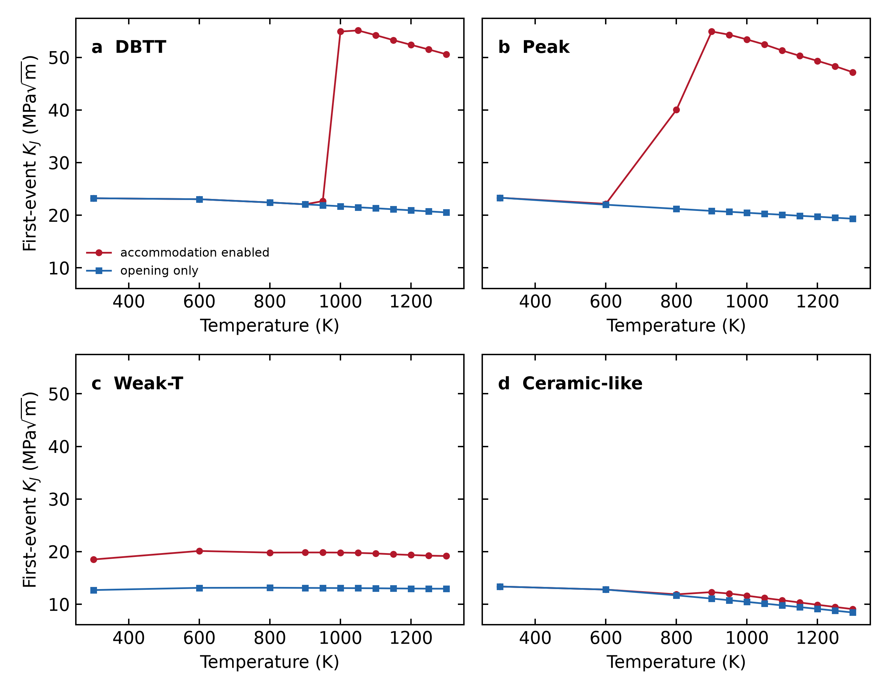

**Figure 2.** Original spatial-PF first-event \(K_J\) for four fixed parameter rows, each evaluated at twelve temperatures with accommodation enabled and with the matched opening-only control. Every one of the 96 predeclared cases reached a physical first event under the common endpoint contract. Curves connect sampled temperatures within a fixed row and arm; they are not fits.

The four constructed rows produce distinct response magnitudes and shapes. DBTT spans 22.08–55.11 MPa√m with accommodation enabled, compared with 20.54–23.23 MPa√m in the opening-only arm. Peak spans 22.17–54.90 MPa√m versus 19.35–23.33 MPa√m. Their largest paired elevations are 156.1% at DBTT/1050 K and 163.7% at Peak/900 K. Weak-T shows a broad elevation: 18.52–20.14 MPa√m enabled versus 12.71–13.15 MPa√m opening-only, with a maximum 53.4% effect at 600 K. Ceramic-like remains the lowest response and has a smaller maximum effect of 11.7% at 950 K.

The family names identify fixed constructed parameter rows, not calibrated materials. The comparison supports the mechanistic statement that inherited accommodation can overwhelm direct opening softening over parts of the temperature domain. It does not uniquely apportion the change among shielding, blunting, transport, and renewed source exposure.

### 5.2 The active-anchor effect exceeds the observed seed spread

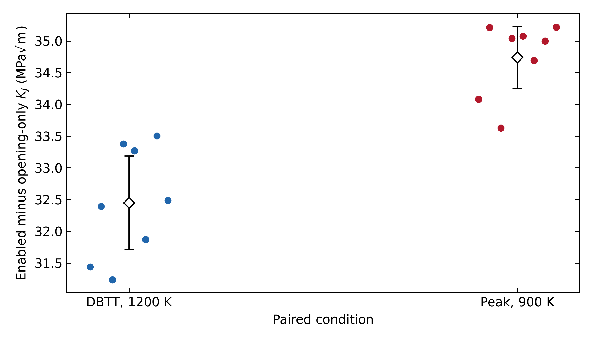

**Figure 3.** Eight predeclared paired seeds at DBTT/1200 K and Peak/900 K. Each point is the enabled-minus-opening-only first-event difference under matched stochastic ownership. Bars show two-sided Student-t intervals for the mean paired gap (7 degrees of freedom); they are not tail or tolerance intervals.

All 32 arm-level calculations fractured. The mean paired gap is 32.45 MPa√m for DBTT/1200 K (sample standard deviation 0.88 MPa√m, empirical range 31.24–33.50 MPa√m, 95% t interval 31.71–33.19 MPa√m). Peak/900 K gives 34.74 MPa√m (standard deviation 0.59 MPa√m, range 33.63–35.22 MPa√m, interval 34.25–35.23 MPa√m). The effect is therefore large relative to the observed eight-seed spread at these two anchors. The finite ensemble does not resolve distribution tails or establish uncertainty for every temperature.

### 5.3 Rate, orientation, and source geography probe the state path

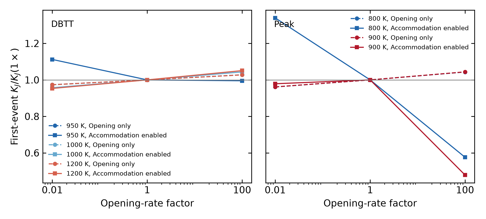

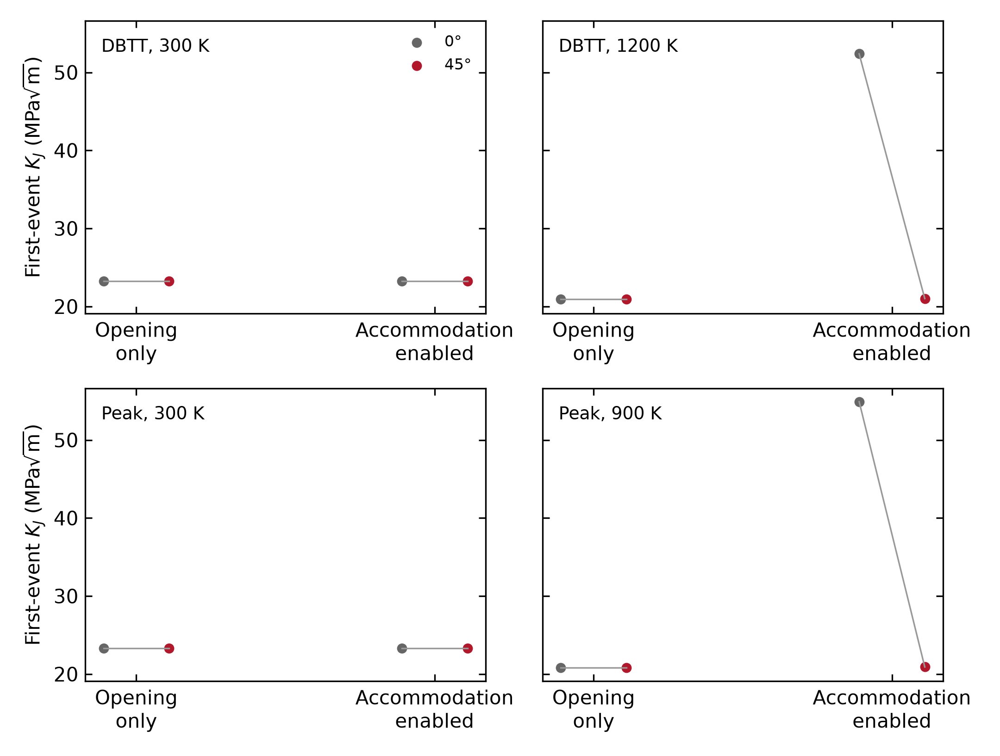

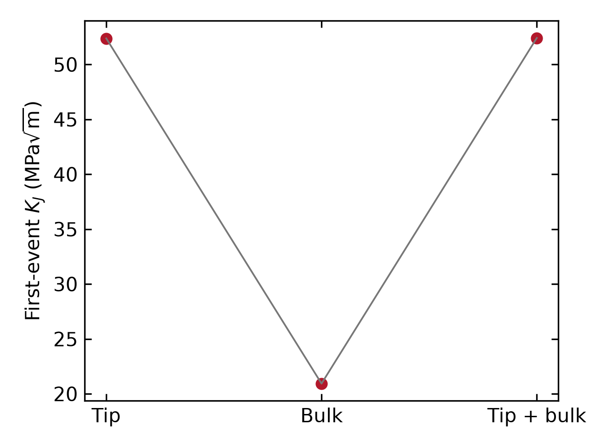

**Figure 4.** Question-driven original spatial-PF sensitivities. (a) Rate factors 0.01, 1, and 100 at five selected material/temperature anchors with matched opening-only arms. (b) 0° and 45° at selected low- and active-accommodation states. (c) tip-surface, bulk-uniform, and tip-plus-bulk source support for DBTT/1200 K. Every Cartesian panel labels its physical x coordinate; no curve is promoted to a global atlas.

Across the selected rate cases, the largest absolute change from the matched 1× first-event coordinate is 52.12%. Changing orientation from 0° to 45° gives paired changes from −61.91% to 0.00%. The cubic elastic tensor is invariant for the chosen constants, so the orientation response arises from the resolved opening and accommodation projections rather than an elastic-modulus change. At DBTT/1200 K, tip-surface, bulk-uniform, and tip-plus-bulk sources give 52.376, 20.934, and 52.414 MPa√m. Uniform source availability is thus not uniform response, and adding bulk support does not simply add to the tip-controlled result. These are local tests of competing kinetics, not transferable correction factors.

### 5.4 Developed growth separates driving history from event resistance

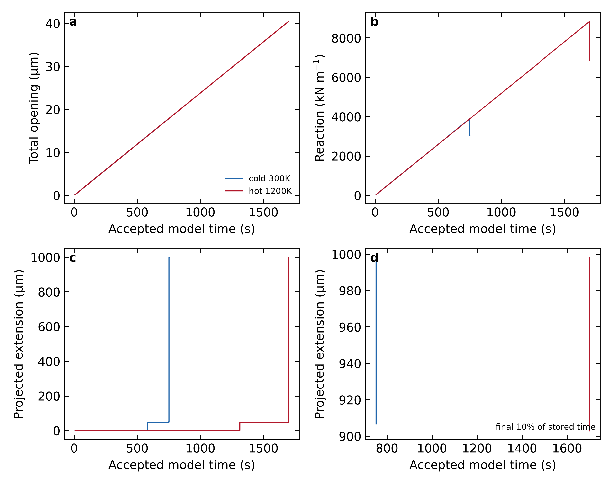

**Figure 5.** Complete chronological native observation histories for DBTT at 300 and 1200 K. Re-equilibrated, exact pre-event, and committed stages retain their actual loading time, opening, reaction, geometry, \(J\), \(K_J\), and process-state associations. Projected extension and path arclength are distinct.

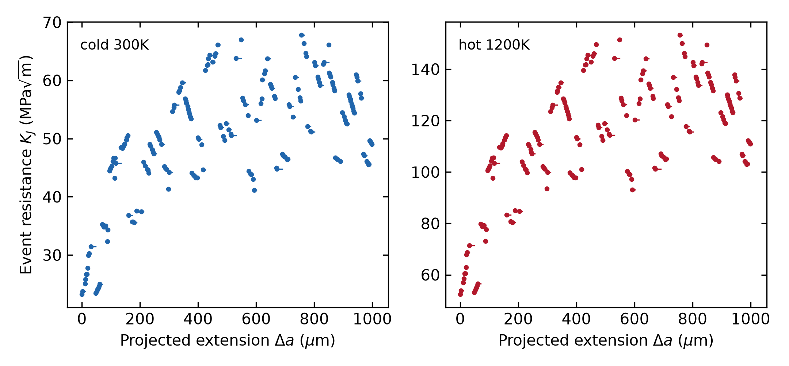

**Figure 6.** Native pre-event J-derived \(K_J\) associated only with each realized committed jump. The 100, 500, and 1000 µm queries are represented by measured lower/upper jump brackets in the accompanying data; no value is interpolated or moved to an uncomputed length.

Both trajectories contain 203 exact pre-event/committed pairs and reach 1004.926 µm projected extension and 1008.560 µm path arclength. The 300 K event coordinates span 23.234–67.807 MPa√m, while the 1200 K coordinates span 52.376–153.307 MPa√m. Their geometry-event files are byte-identical because the common seed provides a controlled common-mark comparison; this is not evidence that morphology is temperature-independent. Each trajectory contains one monotonic loading segment and no independent unload/reload points. We therefore call Figure 6 an event-sampled resistance history rather than a standardized experimental R-curve, and we do not force a rising slope.

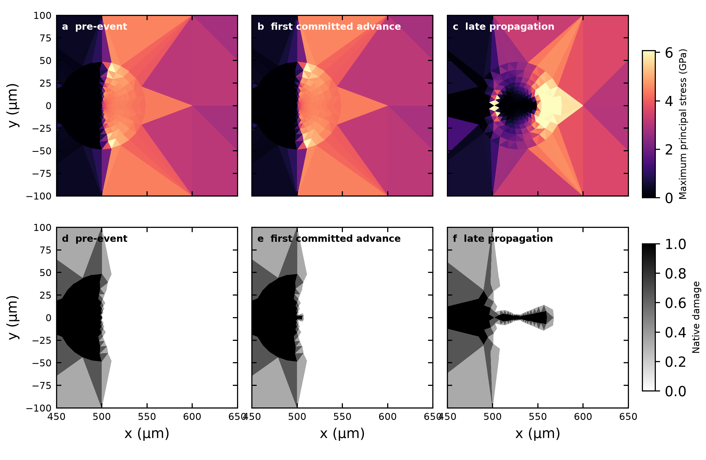

**Figure 7.** Native maximum-principal-stress and damage arrays from the DBTT/1200 K propagation calculation at a pre-event state, the first committed advance, and late propagation. The numerical sidecar gives each exact stored step, crack-tip coordinate, and the \(K_J\) associated with that stored equilibrium. No front-local population is spread into a reconstructed two-dimensional field.

### 5.5 A controlled PF–FEM/CZM comparison

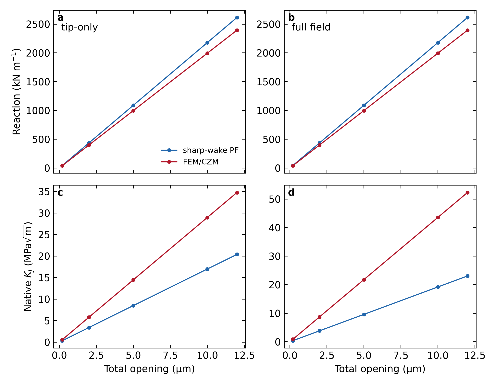

**Figure 8.** Production-history reaction and native \(K_J\) at five common pre-event total openings for the Peak/1000 K, 0°, seed-8666 specimen. Tip-only and full-field states are shown separately. These are common-input comparisons, not a fitted mapping.

On an identical mesh and damage field, the accommodation-disabled reference gives coincident reaction, stored energy, ahead-tip stress, common-domain \(J\), and \(K_J\). The retained production histories do not retain that parity: from 0.2 to 12 µm opening, PF reaction is 1.0923 times FEM/CZM reaction. Native \(K_J^{\rm PF}/K_J^{\rm FEM}\) is 0.5865 for tip-only and approximately 0.4409 for full-field because the production observers use different supports. These differences are present before fracture and, in the tip-only case, before substantial population evolution. They therefore cannot be attributed to the bulk law alone.

The near agreement of the two native first-event coordinates at different openings is not used as mechanical validation. It is consistent with both hazards being driven by their own \(K_J\) coordinate. The supported comparison is narrower: the common operator reference is exact, while production discretization and observer support produce a systematic response difference that the retained runs do not supply a two-level backend-specific convergence sequence to eliminate. The FEM/CZM histories nevertheless contain four accepted physical events, 26 fully separated cohesive subsegments grouped by physical event, and 20.828 µm total cohesive length.

### 5.6 A resolved cavity shields the approach path over the matched window

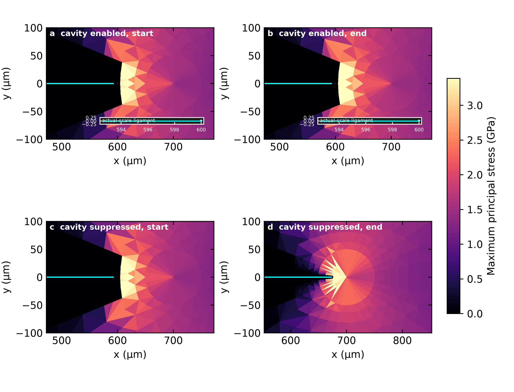

**Figure 9.** Current native maximum-principal-stress fields and crack graphs at the exact start and end checkpoints of the 0.2 s paired continuation. The enabled panels include actual-scale insets spanning the 7.4 µm solid ligament and resolved 42 nm cavity. The suppressed arm advances 80 µm; the enabled arm retains its starting front. Values and mesh sizes are supplied in the numerical sidecar.

The enabled and suppressed arms were resumed from their exact paired checkpoint and loaded for 0.2 s at 1 µm s−1. Both end at 6.6010101 µm total opening. The suppressed arm accepts four ordinary 20 µm advances, increasing graph length by 80 µm. The enabled arm accepts no crack advance; its resolved cavity radius changes only from 42.4796461 to 42.4878668 nm and no crack–void connection forms. At the endpoint, the ordinary front has a valid nested-local-J drive of 4155.24 J m−2, \(K_{\rm eff}=30.9661\) MPa√m, and an effective rate of 3.996 s−1. The cavity approach candidate uses the qualified complete-ligament topology energy, 43.6472 J m−2, \(K_{\rm eff}=3.17371\) MPa√m, and a rate of \(5.39\times10^{-58}\) s−1.

The two quoted endpoint drives are unlike observables at already different geometries: nested local \(J\) for the ordinary front and a finite complete-ligament topology operation for the cavity approach. Their ratio is therefore not a shielding factor. The matched history establishes finite-window inhibition under the executed candidate and kinetic formulation, not permanent arrest, a universal toughening law, or an isolated geometry-only reduction. The cavity predates the continuation, so the result does not predict nucleation. Exact terminal states and topology counts survive; individual event times inside the final window are not reconstructed.

### 5.7 Branching and option-preserving restart scope

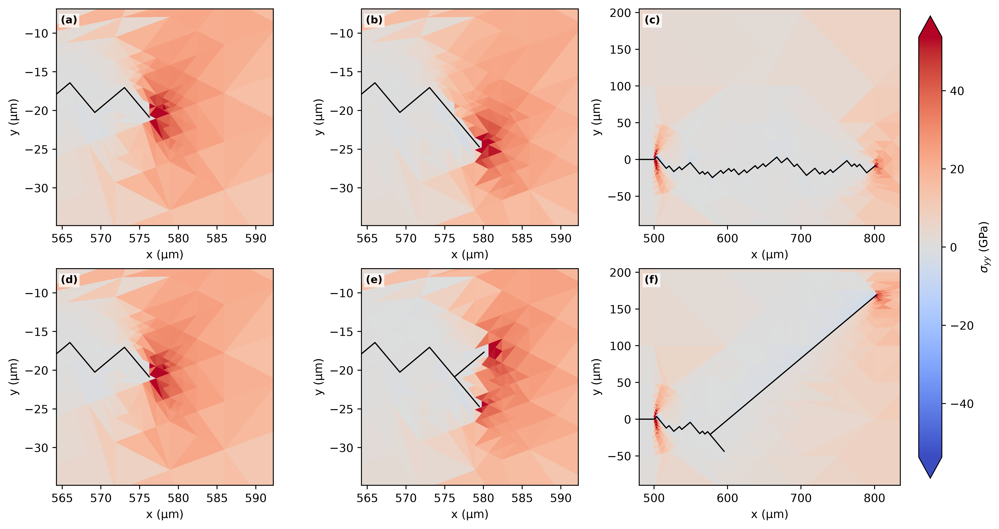

**Figure 10.** Separate accepted branching fields and crack graphs. This morphology example is not pooled with the single-front temperature dataset. A bounded combined branch–cavity compatibility calculation additionally preserves root branch, downstream child, cavity, field transfer, topology ledgers, and exact terminal restart, but does not constitute a calibrated recursive branch-kinetics study.

The combined public route ends with distinct root, child, and cavity owners and reproduces its uninterrupted terminal fingerprint exactly after restart. Separately, the V3.6 cyclic route reproduces a populated native terminal payload exactly at positive load ratio \(R=0.1\). Its mobile density, source-activation, plastic-shear, and cumulative swept ledgers are nonzero; the chosen waveform does not reverse slip sign. These tests establish option and restart preservation only and are not used as fracture-response data.

## 6. Discussion

### 6.1 Transition-like behavior is generated by competing histories

The opening-only curves vary over comparatively narrow ranges for DBTT and Peak, whereas the coupled responses rise to approximately 55 MPa√m. The elevation is therefore a history-dependent accommodation effect under the stated laws, not a prescribed toughness shelf. Conditional opening action accumulates while emission, transport, retention, release, blunting, and source exposure continually change the state on which the next increment acts. The large paired-seed gaps show that this effect is robust at the two active anchors relative to the observed threshold variation, while the small ensemble and constructed material rows prevent a population-tail or named-material claim.

### 6.2 Rate, direction, and source support are not separable scalar shifts

Loading rate changes time available to both opening and accommodation. Crystal rotation changes both opening and slip/source projections. Source geography changes where accommodation can be supplied, but mechanics and transport determine whether it becomes effective. The large pure-bulk decrease at DBTT/1200 K and near identity of tip and tip-plus-bulk values demonstrate why source density cannot be interpreted as an additive toughness term. These sensitivities identify competing state paths; they do not define universal shift factors.

### 6.3 Initiation, driving, and resistance require different stage associations

The developed histories contain physically meaningful resistance information without requiring unload/reload compliance points. \(J\) and \(K_J\) belong to exact equilibrated or pre-event mechanical states, whereas extension belongs to the subsequently committed geometry. Assigning a terminal K to an unobserved post-event state or interpolating across a discrete jump would invent data. The event-conditioned view retains each measured pre-event value across only its realized jump and resolves chronological opening, reaction, extension, and a final-time zoom. Because the histories use one monotonic loading protocol with burst-like advances, they are path- and rate-conditioned resistance histories rather than protocol-independent material R-curves.

### 6.4 Cohesive and sharp-wake implementations share mechanics without being identical

The identical-mesh elastic reference closes the geometry, boundary, unit, stiffness, and base-operator questions. Production histories then show systematic reaction and native-observer differences at common openings. Near equality of first-event \(K_J\) at different openings is expected to be less discriminating because each hazard is driven by its own coordinate; it does not validate production mechanics. The sharp-wake PF implementation is not a variational AT1 or AT2 phase-field model: it carries a stiffness-degraded wake and commits explicit increments when an accumulated kinetic action reaches its mark. FEM/CZM represents hazard-triggered separation through cohesive/topological events. The accepted cohesive state verifies actual separation events, while the remaining production-mesh/support difference limits a stronger cross-code claim.

Baseline AT2 uses \(w(d)=d^2\) and has no finite elastic onset because \(w'(0)=0\); AT1 uses \(w(d)=d\) and has a finite onset. Both can be extended with thermal, viscous, or plastic physics. The present distinction is the explicit physical-time first-passage law coupled to inherited accommodation, not a claim that thermal activation is unavailable to conventional phase field or cohesive fracture.

### 6.5 Cavities change the admissible drive and event competition

The cavity result is qualitative and large over its finite window: the suppressed ordinary front advances while the enabled cavity-approach candidate remains inactive. The important coupling is not cavity span alone but the topology-aware mechanical observer. A contour intersecting a free cavity cannot be used as an ordinary local crack-tip derivative. The qualified complete-ligament operation supplies an admissible approach drive without counting cavity free span as fractured solid, but it is not commensurate with the suppressed arm's terminal local \(J\). The calculation therefore establishes finite-window inhibition under the selected candidate law, with field redistribution and candidate-definition effects not independently decomposed.

### 6.6 Limitations

The parameter rows are constructed and uncalibrated. The accommodation variables are coarse-grained populations; two slip traces and a front-local coordinate do not resolve individual dislocations. The source renewal and Taylor-release mappings are constitutive closures. The baseline curves use one seed per condition, with eight-seed uncertainty only at two active anchors. Rate, orientation, and source studies are deliberately local. The developed paths share common-mark geometry and one monotonic load segment. PF/FEM comparison is on one material/temperature/seed condition and retains different production discretizations. The cavity comparison is one paired realization with a finite 0.2 s continuation, and its inner event chronology is unavailable after the exporter failure. These limits constrain inference without weakening the directly observed comparisons.

## 7. Conclusions

1. Fixed opening and accommodation landscapes generate distinct temperature-response classes without prescribing toughness curves; for the current DBTT and Peak rows, accommodation raises selected first-event coordinates by more than 150% relative to matched opening-only controls.
2. At DBTT/1200 K and Peak/900 K, the accommodation-associated gaps are much larger than the observed spread across eight paired seeds, although distribution tails and other temperatures remain unresolved.
3. Rate, orientation, and source geography act through the evolving state path. Their effects cannot be represented by a universal horizontal shift or additive source-density correction.
4. Developed 1 mm trajectories require stage-faithful reporting: the native pre-event coordinates form an event-sampled monotonic resistance history, not independent unload/reload R-curve points.
5. Original PF and FEM/CZM calculations share exact elastic mechanics on the identical-mesh reference, but production histories differ systematically in reaction and native \(J\) support at common openings; close event coordinates alone do not validate production mechanics.
6. In the matched finite cavity continuation, the suppressed arm advances 80 µm and the enabled arm does not advance or connect; this establishes finite-window inhibition under the executed topology-aware candidate law, not a ratio-based shielding factor or permanent arrest.

## Data and code availability

The accompanying package contains plotted numerical tables, source mappings, campaign definitions, hashes, commands, and validated manuscript/SI exports. Full native histories, meshes, and checkpoints remain in the hashed evidence roots listed by the reproducibility manifest rather than being duplicated in the compact paper package. No reduced, surrogate, fitted-transfer, or frozen-state rethresholded trajectory is used as numerical evidence.

## References
1. A. A. Griffith, “The phenomena of rupture and flow in solids,” *Philosophical Transactions of the Royal Society A* **221** (1921) 163–198. https://doi.org/10.1098/rsta.1921.0006
2. J. R. Rice and R. Thomson, “Ductile versus brittle behaviour of crystals,” *Philosophical Magazine* **29** (1974) 73–97. https://doi.org/10.1080/14786437408213555
3. J. R. Rice, “Dislocation nucleation from a crack tip: an analysis based on the Peierls concept,” *Journal of the Mechanics and Physics of Solids* **40** (1992) 239–271. https://doi.org/10.1016/S0022-5096(05)80012-2
4. H. A. Kramers, “Brownian motion in a field of force and the diffusion model of chemical reactions,” *Physica* **7** (1940) 284–304. https://doi.org/10.1016/S0031-8914(40)90098-2
5. J. R. Rice, “A path independent integral and the approximate analysis of strain concentration by notches and cracks,” *Journal of Applied Mechanics* **35** (1968) 379–386. https://doi.org/10.1115/1.3601206
6. J. R. Rice and G. E. Beltz, “The activation energy for dislocation nucleation at a crack,” *Journal of the Mechanics and Physics of Solids* **42** (1994) 333–360. https://doi.org/10.1016/0022-5096(94)90013-2
7. A. S. Argon, “Brittle to ductile transition in cleavage fracture,” *Acta Metallurgica* **35** (1987) 185–196. https://doi.org/10.1016/0001-6160(87)90228-8
8. V. Tvergaard and J. W. Hutchinson, “The relation between crack growth resistance and fracture process parameters in elastic-plastic solids,” *Journal of the Mechanics and Physics of Solids* **40** (1992) 1377–1397. https://doi.org/10.1016/0022-5096(92)90020-3
9. A. Azizi and S. J. Dillon, “An Arrhenius–hazard approach to strength additivity, dynamic strain aging, and yield surfaces,” *Acta Materialia* **316** (2026) 122461. https://doi.org/10.1016/j.actamat.2026.122461
10. L. Ambrosio and V. M. Tortorelli, “Approximation of functionals depending on jumps by elliptic functionals via Γ-convergence,” *Communications on Pure and Applied Mathematics* **43** (1990) 999–1036.
11. G. A. Francfort and J.-J. Marigo, “Revisiting brittle fracture as an energy minimization problem,” *Journal of the Mechanics and Physics of Solids* **46** (1998) 1319–1342.
12. B. Bourdin, G. A. Francfort, and J.-J. Marigo, “Numerical experiments in revisited brittle fracture,” *Journal of the Mechanics and Physics of Solids* **48** (2000) 797–826.
13. K. Pham, H. Amor, J.-J. Marigo, and C. Maurini, “Gradient damage models and their use to approximate brittle fracture,” *International Journal of Damage Mechanics* **20** (2011) 618–652. https://doi.org/10.1177/1056789510386852
14. C. Miehe, F. Welschinger, and M. Hofacker, “Thermodynamically consistent phase-field models of fracture,” *International Journal for Numerical Methods in Engineering* **83** (2010) 1273–1311. https://doi.org/10.1002/nme.2861
