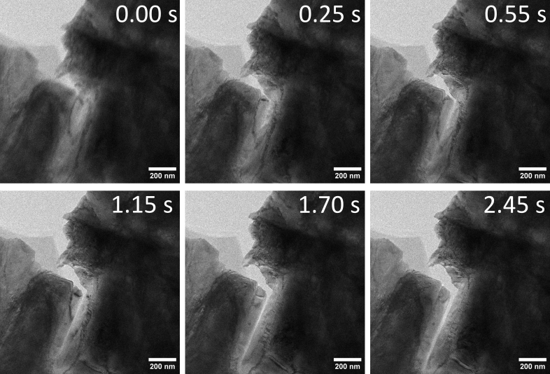

# Supporting Information

## Temperature- and rate-dependent fracture from competing crack-tip kinetics

## S1. Experimental-image scope

The two experimental composites contain selected transmission-electron-microscopy frames of crack opening in nominally 500 nm, 99.9% Ag leaf. One sequence shows extensive evolving line and band contrast described as dislocation motion and twinning; the second shows less visible plastic contrast. Both carry 200 nm scale bars. Frame selection is nonuniform, and synchronized force and raw timebase data are unavailable. The images therefore motivate the coexistence of opening and accommodation pathways but do not calibrate an activation landscape or validate a quantitative load–temperature curve.

**Figure S1.** Selected frames from the companion Ag sequence with limited visible plastic contrast. Visibility depends on thickness, diffraction condition, orientation, and temporal resolution; limited contrast is not proof of absent plasticity.

## S2. Mechanical problem and loading

The principal calculation is plane strain in a 2 mm by 4 mm body with a 0.5 mm left-edge notch. Symmetric prescribed displacement on the upper and lower boundaries produces nominal mode-I opening. A graded triangular mesh resolves the stress field. Cubic constants are \(C_{11}=523\), \(C_{12}=203\), and \(C_{44}=160\) GPa. Their Zener ratio is one, so the elastic stiffness is invariant to the rotation test, while local opening and source/slip projections change.

The field-derived coordinate is

\[
K_J=\sqrt{E'\max(\varsigma J_{\rm signed},0)}.
\]

Accepted opening commits an explicit sharp-wake increment through the model’s stiffness-degradation representation. The primary calculations stop at the first accepted increment or 100 μm applied opening. Representative propagation paths continue to at least 50 μm projected extension or a 150 μm opening ceiling.

## S3. Conditional hazards and activation surfaces

For mechanism \(i\),

\[
\lambda_i(t)=\mathcal M_i(t)\nu_i
\exp\!\left[-\frac{\Delta G_i^\ddagger(q_i(t),T,z(t))}{k_BT}\right],
\]

and, on a no-event interval,

\[
f_i(t)=\lambda_i(t)
\exp\!\left[-\int_{t_0}^{t}\sum_j\lambda_j(s)\,ds\right].
\]

Emission is nonabsorbing and changes subsequent rates. Opening uses a three-hit renewal rate over \(10^{-6}\) s and an exponential threshold:

\[
A_c(t)=\int_{t_0}^{t}\Lambda_c[s;z(s)]\,ds,\qquad
A_c(t_c)=\Xi,\qquad \Xi=-\ln R,\quad R\sim U(0,1).
\]

Opening and emission have EXP-floor surfaces

\[
G_i(\sigma,T)=G_{f,i}+[G_{0,i}(T)-G_{f,i}]
\exp\!\left\{-\alpha_i
\left[\frac{\max(\sigma,0)}{\sigma_{c,i}(T)}\right]^{n_i}\right\},
\]

\[
G_{0,i}=G_{00,i}+g_{T,i}(T-T_{\rm ref}),\qquad
\sigma_{c,i}=\sigma_{c0,i}+s_{T,i}(T-T_{\rm ref}),\qquad
\lambda_i=\nu_i e^{-G_i/(k_BT)}.
\]

In the executed PF routine, \(G_0\) is clamped below at \(10^{-9}\) eV, \(\sigma_c\) at 1 Pa, and

\[
G_f=\min[0.95G_0,\max(10^{-4}\ {\rm eV},fG_0)].
\]

Only the tensile part \(\max(\sigma,0)\) enters the surface. The Arrhenius exponent is clipped to \([-700,0]\) before exponentiation. These are runtime definitions, not plotting conventions. A consequential domain feature is that the affine DBTT emission stress scale reaches zero near 1001 K and is thereafter held at the 1 Pa numerical lower bound; thus essentially any positive resolved emission stress places that surface at its bounded floor above this temperature. The upper-branch calculation is reported with this constitutive limitation rather than cosmetically extending the affine law.

## S4. Mean finite-source and process-zone update

The original spatial PF solver carries a native coarse-grained moving state with two slip-trace channels and 80 bins over 50 μm, giving \(\Delta x=0.625\) μm. Each channel initially contains

\[
C_s=141.0590567476921
\]

continuum source-opportunity units. The total instantaneous local capacity is 282.1181134953842. These are integration weights in a mean population law rather than counts of individually sampled atomic sources.

For channel \(s\),

\[
\sigma_{e,s}=\max(f_s\sigma_{\rm open}-\sigma_{{\rm back},s},0),\qquad
\lambda_{e,s}=\nu_e e^{-G_e(\sigma_{e,s},T)/(k_BT)},
\]

\[
\Delta N_s=S_s[1-e^{-\lambda_{e,s}\Delta t}],\qquad
S_s\leftarrow S_s-\Delta N_s.
\]

New content enters the first two bins as mobile population. With mobile \(M_s(x)\), retained \(R_s(x)\), forest spacing \(\ell\), velocity \(v\), and encounter rate \(k_{\rm enc}\),

\[
\ell=(2\sqrt{\rho})^{-1},\qquad
v=\ell\lambda_p,\qquad
k_{\rm enc}=\eta v\sqrt{\rho},
\]

\[
\dot M_s=-k_{\rm enc}M_s+k_{\rm rel}R_s,\qquad
\dot R_s=k_{\rm enc}M_s-k_{\rm rel}R_s.
\]

The local two-state exchange is integrated exactly over each subinterval. Mobile content is then transported forward by \(v\Delta t\). Explicit mobile and retained recovery are zero. Taylor completion is mapped to release through

\[
k_{\rm rel}=
\frac{P[m,\min(\lambda_t,10^{12}\ {\rm s}^{-1})t_0]}{t_0},
\qquad t_0=1\ {\rm s}.
\]

Only signed retained content contributes to shielding:

\[
r_{\rm eff}=r_0+c_{\rm blunt}b\sum_{s,j}w_j\Gamma_{s,j},
\qquad
K_{\rm sh}=\sum_{s,j}\kappa_{s,j}R_{s,j}^{\rm signed},
\]

\[
\sigma_c=\frac{\max(K_J-K_{\rm sh},0)}
{\sqrt{2\pi r_{\rm eff}}}.
\]

Mobile and wake shielding are disabled. Emission uses the unshielded opening stress and subtracts Taylor back stress only in its own channel.

## S5. Partial opening progress and moving-coordinate closure

Let \(B\) be fractional progress toward an accepted sharp-wake increment of length \(L_c\). Within an outer mechanical interval,

\[
d\xi=L_c\,dB.
\]

The active mobile, retained, and slip fields translate toward the moving origin by \(d\xi\). Content crossing that origin enters the wake. The local source opportunity renews as

\[
S_s\leftarrow S_s+(C_s-S_s)
\min(d\xi/L_{\rm ref},1),
\qquad
L_{\rm ref}=\max(L_{\rm manifest},\Delta x)=0.625\ \mu{\rm m}.
\]

The sharp-wake geometry remains unchanged until \(B=1\), when \(L_c\) is committed. The continuous coordinate is therefore an expected subgrid opening-progress displacement used to evolve front-local state, not an independently resolved crack surface. It allows shielding, radius, transport, and source exposure to influence mechanics during partial progress. This continuous-state/discrete-geometry relation is a constitutive closure and an important physical limitation.

Current capacity, current mobile-plus-retained content, and cumulative emission are different quantities. Crack motion exposes fresh local opportunity, so the finite current capacity does not globally bound cumulative emission.

## S6. Material parameters

Energies are in eV, energy slopes in eV K\(^{-1}\), stresses in GPa, stress slopes in GPa K\(^{-1}\), and densities in m\(^{-2}\). A machine-readable table supplied with the article preserves all digits.

### Table S1. Opening parameters

| Family | \(G_{00}\) | \(g_T\) | \(\sigma_{c0}\) | \(s_T\) | \(\alpha\) | \(n\) | floor |
|---|---:|---:|---:|---:|---:|---:|---:|
| Peak | 4.0118 | 0.0081468 | 7.3496 | -0.0012100 | 1.3228 | 1.2558 | 0.018451 |
| DBTT | 2.3577 | 0.0056085 | 6.7501 | -0.0012041 | 0.49684 | 2.6188 | 0.026239 |
| Weak-T | 3.0409 | 0.0064702 | 5.0254 | -0.0014868 | 0.97559 | 1.0790 | 0.025475 |
| Ceramic-like | 3.2733 | 0.0085807 | 4.6647 | -0.0020771 | 1.0759 | 1.0818 | 0.022991 |

### Table S2. Emission parameters

| Family | \(G_{00}\) | \(g_T\) | \(\sigma_{c0}\) | \(s_T\) | \(\alpha\) | \(n\) | floor |
|---|---:|---:|---:|---:|---:|---:|---:|
| Peak | 2.0446 | 0.0009420 | 7.2052 | 0.0013326 | 0.085872 | 1.1423 | 0.0058420 |
| DBTT | 3.3449 | 0.0061668 | 2.7143 | -0.0052233 | 0.15725 | 0.51562 | 0.010368 |
| Weak-T | 2.9331 | -0.00042943 | 1.4962 | -0.000042793 | 0.26802 | 1.5518 | 0.064524 |
| Ceramic-like | 3.1909 | -0.0024372 | 8.7375 | 0.0040232 | 0.43370 | 0.74084 | 0.0083828 |

### Table S3. Peierls and Taylor parameters

| Family | \(H_{0,p}\) | \(\Delta S_p/k_B\) | \(\alpha_p\) | \(n_p\) | \(H_{0,t}\) | \(\Delta S_t/k_B\) | \(\alpha_t\) | \(n_t\) |
|---|---:|---:|---:|---:|---:|---:|---:|---:|
| Peak | 6.3684 | 12.2266 | 1.9098 | 1.1373 | 1.6987 | 38.4538 | 0.45612 | 1.2507 |
| DBTT | 3.5257 | -36.3393 | 1.4484 | 1.8713 | 1.4998 | 31.3659 | 0.70489 | 0.53896 |
| Weak-T | 4.8567 | -30.9531 | 1.0104 | 2.3834 | 1.8921 | 39.5363 | 0.52685 | 1.4233 |
| Ceramic-like | 6.5849 | -5.1265 | 1.4449 | 0.79892 | 1.1080 | -9.2766 | 0.74570 | 2.2320 |

### Table S4. Correlation and feedback parameters

| Family | \(\rho_c\) | correlation scale | source/channel | encounter efficiency | \(c_{\rm blunt}\) |
|---|---:|---:|---:|---:|---:|
| Peak | \(5.8780\times10^{13}\) | 0.86390 | 141.0591 | 9.16025 | 2.6873 |
| DBTT | \(2.2042\times10^{13}\) | 1.2690 | 141.0591 | 9.16025 | 2.9292 |
| Weak-T | \(2.0520\times10^{16}\) | 0.10446 | 141.0591 | 9.16025 | 1.5308 |
| Ceramic-like | \(1.2482\times10^{17}\) | 1.8464 | 141.0591 | 9.16025 | 0.46276 |

### Table S5. Common state parameters

| Quantity | Value |
|---|---:|
| Reference temperature | 481.33 K |
| Slip channels | 2 |
| Process-zone bins / length | 80 / 50 μm |
| Forest-density floor | \(5.0\times10^{12}\ {\rm m}^{-2}\) |
| Peierls and Taylor stress fractions | \(1/\sqrt{3}\) |
| Opening / emission attempt frequency | \(10^{12}\) / \(10^{11}\ {\rm s}^{-1}\) |
| Peierls / Taylor attempt frequency | \(10^{12}\) / \(10^{11}\ {\rm s}^{-1}\) |
| Mobile shielding fraction | 0 |
| Temporal source, mobile, and retained recovery | 0 |
| Source reference area / front width / zone length | 25 μm² / 10 μm / 2 μm |

## S7. Current 96-case baseline and seed uncertainty

The current baseline contains four fixed rows, twelve temperatures (300, 600, 800, 900, 950, 1000, 1050, 1100, 1150, 1200, 1250, and 1300 K), and two arms. Seed 1733, 0° orientation, unit loading-rate factor, and tip-surface source geography are held fixed. All 96 cases have verified runtime attestations and physical first events.

| Row | Enabled range (MPa√m) | Opening-only range (MPa√m) | Largest paired change |
|---|---:|---:|---:|
| DBTT | 22.08–55.11 | 20.54–23.23 | 156.1% at 1050 K |
| Peak | 22.17–54.90 | 19.35–23.33 | 163.7% at 900 K |
| Weak-T | 18.52–20.14 | 12.71–13.15 | 53.4% at 600 K |
| Ceramic-like | 9.08–13.38 | 8.45–13.38 | 11.7% at 950 K |

Eight paired seeds at DBTT/1200 K and Peak/900 K were chosen before inspecting outcomes. The two-sided Student-t intervals use 7 degrees of freedom and assume independent seeds and approximate normality of paired gaps. They estimate the mean gap, not population tails.

| Anchor | mean gap | sample SD | empirical range | 95% t interval |
|---|---:|---:|---:|---:|
| DBTT, 1200 K | 32.45 | 0.88 | 31.24–33.50 | 31.71–33.19 |
| Peak, 900 K | 34.74 | 0.59 | 33.63–35.22 | 34.25–35.23 |

All numerical entries are in MPa√m. Full precision and individual seeds are in `figure_data/PF_FOCUSED_SEEDS_PAIRED.csv`.

## S8. Current rate, orientation, and source matrix

Forty predeclared rows test rate factors 0.01, 1, and 100 at five anchors, 0°/45° orientation at four selected conditions, and three source geographies at DBTT/1200 K. Every row reaches a physical first event. The largest absolute rate change relative to 1× is 52.12%; the 45° minus 0° changes range from −61.91% to 0.00%. At DBTT/1200 K the tip-surface, bulk-uniform, and tip-plus-bulk results are 52.376, 20.934, and 52.414 MPa√m. The 45° operator is the original two-pass self-consistent signed-kernel family; the target-family kernel arrays are unchanged between capture/build passes.

## S9. Developed-growth observer contract

The 300 and 1200 K paths each contain 203 geometry events and 3695 chronological observation rows across the paired dataset. A resistance row uses the native J-derived \(K_J\) measured at the exact pre-event state and associates it with only the subsequent realized committed jump. The committed coordinate has no invented post-event J or K. Queries at 100, 500, and 1000 µm preserve the measured lower pre-event and upper committed coordinates; interpolation is false for every query.

| Temperature | Initial event coordinate | observed range | terminal event coordinate | projected / arclength |
|---:|---:|---:|---:|---:|
| 300 K | 23.234 | 23.234–67.807 | 49.039 | 1004.926 / 1008.560 µm |
| 1200 K | 52.376 | 52.376–153.307 | 110.873 | 1004.926 / 1008.560 µm |

The paths have one monotonic loading segment and zero independent reload-resistance points. Active mobile-plus-retained population is a current state and is never relabeled cumulative emission.

## S10. Common-specimen PF–FEM/CZM contract

The shared specimen is plane strain, 2 mm × 4 mm, with a 0.5 mm initial notch and total opening imposed as +U/2 and −U/2. Force is per unit out-of-plane thickness. Identical-mesh elastic calculations match reaction, stored energy, ahead-tip stress, common-domain J, and K at total openings 0.2, 10, and 30 µm with maximum relative difference zero at stored precision.

| Scope | PF first-event K | FEM/CZM first-event K | relative difference | PF / FEM opening |
|---|---:|---:|---:|---:|
| Tip-only | 53.878 | 54.212 | 0.62% | 31.723 / 18.720 µm |
| Full-field | 51.110 | 54.407 | 6.06% | 26.610 / 12.492 µm |

K values are MPa√m. Openings are native observations, not parity metrics. The original PF uses a sharp-wake increment, while FEM/CZM uses adaptive cohesive topology; production meshes and J supports differ.

## S11. Recovered physical cavity continuation

The DBTT/1200 K/seed-3621 pair uses the qualified full-field plasticity and positive conservative vacancy transport. After the unchanged migration dwell and accepted ramp suffixes, the final matched continuation runs from physical time 6.0010201 to 6.2010201 s and from total opening 6.4010101 to 6.6010101 µm.

| Quantity | Cavity enabled | Cavity suppressed |
|---|---:|---:|
| Graph-length change | 0 µm | 80 µm |
| Terminal reaction | 575712.14 N m−1 | 501039.17 N m−1 |
| Terminal admissible energy drive | 43.6472 J m−2 | 4155.24 J m−2 |
| Terminal effective K | 3.17371 MPa√m | 30.9661 MPa√m |
| Terminal effective rate | 5.39093×10−58 s−1 | 3.99577 s−1 |

The enabled cavity grows from 42.4796461 to 42.4878668 nm. No connection forms, and all fractured/free-span ledgers remain zero. The suppressed arm accepts four 20 µm ordinary increments. The exact native pair checkpoint survives a round trip. Because a generic JSON normalizer failed after execution, exact event times within this 0.2 s suffix are unavailable and are not reconstructed.

## S12. Preserved active restart and combined topology

At 15.462475 MPa√m and R=0.1, interrupted and uninterrupted V3.6 terminal payloads are exactly equal. The terminal state contains maximum mobile density 5.348994×10^15 m−2, cumulative source activation 1.097165×10^4, and nonzero material-frame plastic shear/cumulative swept ledgers (1.882753×10−13). The positive-R waveform does not reverse slip sign.

The public combined branch–cavity route preserves root branch `b00000000`, active child `void-front-1`, and cavity `void:site-1`. Its terminal graph length is 795 µm and cavity radius 55 µm. Restart reproduces the uninterrupted terminal fingerprint exactly while conserving the field-transfer ledgers to their declared tolerances. This is a compatibility qualification of existing laws, not a recursive-branch calibration or production fracture result.

## S13. Cohesive and energetic comparison

For cohesive energy \(\phi(\delta)\), traction \(t_n\), and activation area \(A_*\),

\[
\mathcal F(\delta)=A_*[\phi(\delta)-t_n\delta],
\]

\[
\Delta G_c^\ddagger=A_*\int_{\delta_m}^{\delta_s}
[t_{\rm coh}(\delta)-t_n]\,d\delta,\qquad
V_c^\ddagger=A_*(\delta_s-\delta_m).
\]

The derivative is taken at fixed cohesive landscape and traction-controlled loading ensemble. Different cohesive shapes with equal peak strength and work can still produce different barrier trajectories and activation volumes.

Baseline AT2 regularization uses \(w(d)=d^2\), whereas AT1 uses \(w(d)=d\). Their different behavior near \(d=0\) gives AT1 a finite elastic onset and AT2 no finite onset in the baseline formulation. Both can be extended with viscosity, thermal fields, plasticity, or cohesive degradation. The present model differs in assigning conditional physical-time rates to opening and accommodation and in retaining a front-local population history.

**Figure S4.** Accepted branching stress fields and crack graphs from the separate morphology calculation. The plate demonstrates a broader spatial crack capability but is not part of the single-front temperature and rate dataset.

## S14. Figure and data provenance

Every current quantitative plot is copied from, or regenerated solely from, the accepted CSV/JSON records in `review_packet/final_fracture_campaign_a5a5883`. Historical C19 field plates retained in Figures 9 and 10 are actual original full-order fields and are labeled for their limited geometric/provenance role. `reproducibility/CLAIM_TO_EVIDENCE_INDEX.json` maps major claims to exact files and `SOURCE_AND_INPUT_MANIFEST.json` records SHA-256 hashes and producer roots. No reduced/hybrid result is included in a numerical table or figure.
